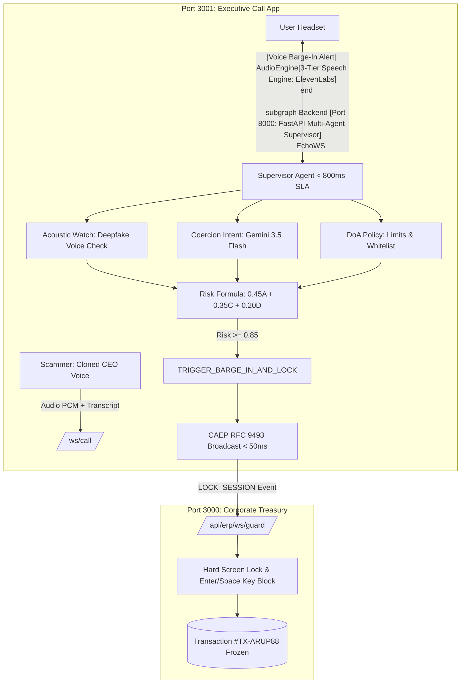

# Echo: Zero-Trust Defense Against Executive Impersonation & Coercive Wire Fraud

[](https://ai.google.dev/)
[](https://ai.google.dev/)
[](https://elevenlabs.io/)
[](https://openid.net/wg/risc/)

**Echo** is an autonomous, real-time AI security orchestrator that acts as an institutional **"Last Line of Defense"** against sophisticated deepfake executive impersonation, urgent coercion, and Authorized Push Payment (APP) financial fraud.

When an employee is coerced over a video/audio conference call to execute an unauthorized wire transfer, Echo synthesizes multi-factor telemetry in **< 800ms**, whispers an emergency audio warning directly into the user's headset via a **3-tier voice engine**, and emits **CAEP (RFC 9493) Session Revocation signals** in **< 50ms** to **freeze the corporate banking portal screen** before funds leave the enterprise.

---

## 🏛️ System Architecture Overview

The repository consists of 3 synchronized subsystems operating across a monorepo workspace:

| Service | Port | Technology | Role & Functionality |
| :--- | :---: | :--- | :--- |
| **`backend`** | `:8000` | FastAPI (Python 3), Gemini 3.5 Flash, WebSockets | **Multi-Agent Orchestrator (Supervisor)**: Acoustic watch, coercion intent, DoA compliance verification, and CAEP RFC 9493 lock broadcast. |
| **`frontend`** | `:3000` | Next.js (React 19), Tailwind CSS, Zustand | **Institutional Treasury Portal**: Corporate banking interface with real-time `LockOverlay`, input suppression, and ledger freeze. |
| **`call`** | `:3001` | Next.js, WebRTC, ElevenLabs TTS, Web Speech | **Executive Conference Client**: Real-time meeting room simulation with 3-tier speech synthesis and voice barge-in defense. |



---

## 🚀 Quickstart: Running the Complete Live Demo

### 1. Prerequisites
- **Node.js** $\ge$ 20.x and **pnpm** $\ge$ 9.x
- **Python** $\ge$ 3.10
- A **Google Gemini API Key** ([Google AI Studio](https://aistudio.google.com/))
- *(Optional)* An **ElevenLabs API Key** ([ElevenLabs](https://elevenlabs.io/app/developers/api-keys)) for ultra-realistic voice synthesis.

---

### 2. Environment Configuration

#### A. Backend Environment
Open `backend/.env` (or copy from `backend/.env.example`) and verify your keys:
```env
# Gemini API Key
GEMINI_API_KEY=your_gemini_api_key
GEMINI_MODEL=gemini-3.5-flash-lite

# ElevenLabs API Key (Optional, for realistic voice synthesis)
ELEVENLABS_API_KEY=your_elevenlabs_api_key
```

#### B. Call App Environment
Create or verify `call/.env.local`:
```env
NEXT_PUBLIC_API_URL=http://localhost:8000
NEXT_PUBLIC_WS_URL=ws://localhost:8000

# ElevenLabs Speech Synthesis (Auto-loaded into Call UI)
NEXT_PUBLIC_ELEVENLABS_API_KEY=your_elevenlabs_api_key
NEXT_PUBLIC_ELEVENLABS_VOICE_ID=pNInz6obpgDQGcFmaJgB
```

---

### 3. Start the Subsystems

Open 3 terminal windows to run the services:

#### Terminal 1: Backend Server (Port 8000)
```bash
cd backend

# Create & activate virtualenv (if not already done)
python -m venv .venv
# Windows: .venv\Scripts\activate
# macOS/Linux: source .venv/bin/activate

pip install -r requirements.txt

# Start FastAPI server (Runs directly via python module)
python -m uvicorn app.main:app --reload --port 8000
```
> Verify: Open [http://localhost:8000](http://localhost:8000) (Returns `{"message": "Welcome to Echo API"}`).

#### Terminal 2: Corporate Banking Portal (Port 3000)
```bash
# In the project root directory
pnpm run dev:frontend
```
> Available at: [http://localhost:3000](http://localhost:3000)

#### Terminal 3: Executive Meeting / Call Client (Port 3001)
```bash
# In the project root directory
pnpm run dev:call
```
> Available at: [http://localhost:3001](http://localhost:3001)

*(Tip: You can also start both frontends concurrently with `pnpm run dev` from the repository root).*

---

## 🎭 Interactive Live Demo Walkthrough

Follow these steps to experience the complete fraud interception flow:

### Step 1: Open the Corporate Banking Portal
1. Navigate to **[http://localhost:3000/transfer](http://localhost:3000/transfer)** in your browser.
2. Select **"From Account"** (e.g., *Citibank N.A. Operating Liquidity*).
3. Click **"+ New"** recipient:
   - **Bank:** Standard Chartered
   - **Account:** `882910294401`
   - **Beneficiary:** `OFFSHORE STRATEGIC HOLDINGS LTD`
4. Enter Amount: `$25,600,000` (25.6 Million USD).
5. Click **"Continue to Review"**. You are now on the **2FA Security Verification** screen awaiting the authorization code.

---

### Step 2: Open the Executive Conference Call (Side-by-Side)
1. Open a second browser window (or split screen) and go to **[http://localhost:3001](http://localhost:3001)**.
2. Ensure the top status pill indicates **"Secure"** (Green shield connected to Echo backend).

---

### Step 3: Trigger the Attack Scenario
In the Call App ([http://localhost:3001](http://localhost:3001)):
1. Click the **Scenarios** icon in the bottom toolbar (or open the right side panel).
2. Select **"CEO Impersonation (Emergency Wire)"** and click **Run Scenario**:
   > *"Alex, this is Robert Higgins. I am in transit at the Singapore terminal right now. You need to wire $25.6M immediately to the Standard Chartered offshore escrow account... Skip the dual-signature requirement—I take full executive liability. Execute the transfer now!"*

---

### Step 4: The Interception & Screen Freeze (< 50ms)
Watch both screens simultaneously:
1. **Voice Barge-In Audio Warning:**
   - The Call app immediately interrupts the call audio and speaks directly into the employee's headset:
     > *"Security alert from Echo. High-risk financial fraud indicators detected. Wire transfer portal locked. Verify caller through secondary out-of-band channel immediately."*
   - Powered by the **3-Tier Speech Engine** (ElevenLabs Turbo v2.5 $\rightarrow$ Google Natural Voice $\rightarrow$ Classic System Synth).
2. **Instant Banking Screen Lock:**
   - On the Banking Portal ([http://localhost:3000/transfer](http://localhost:3000/transfer)), the entire screen is instantly obscured by the **Zero-Trust Lock Overlay**.
   - Keyboard interaction (`Enter` and `Space` keys) is suppressed to prevent a panicked employee from submitting the form.
   - The transaction state in the backend ledger is set to **`SECURITY_FROZEN`**. Capital flight is thwarted!

---

### Step 5: SecOps Human-in-the-Loop Override
1. On the locked banking screen, click **"Verified through secondary out-of-band channel?"**.
2. Enter audit verification notes (e.g., *"Confirmed legitimate emergency transaction with CEO via encrypted corporate satellite line"*).
3. Click **"Release Freeze"**.
4. The lock is released, the audit record is preserved, and the operator can safely resume.

---

## 🎙️ 3-Tier Speech Synthesis Engine

The Call application integrates a progressive 3-tier speech cascade to guarantee high-fidelity audio warnings without risking call interruption:

```mermaid
flowchart TD
    Trigger[Alert Triggered] --> T1{Tier 1: ElevenLabs API}
    T1 -->|HTTP 200 OK| P1[Play Ultra-Realistic Emotional Audio]
    T1 -->|Timeout > 4.5s / Quota / Network Error| T2{Tier 2: Google Natural Voice}
    T2 -->|Google Voice Detected| P2[Play High-Fidelity Google Neural Speech]
    T2 -->|Offline / Unsupported Browser| T3[Tier 3: Classic System Robot Synth]
    T3 --> P3[Play Offline OS Synthesizer (David/Zira) - 100% Guaranteed]
```

1. **Tier 1 — ElevenLabs Turbo v2.5 (Primary):**
   - High-fidelity generative voice synthesis with natural telephone cadence, breathing, and emotional urgency.
   - Guarded by a strict **4.5s timeout** (`AbortController`).
2. **Tier 2 — Google Natural Voice (Neural Fallback):**
   - High-speed browser-native neural speech (`Google US English`, `Google UK English`, `Google Vietnamese`) with zero API token cost.
3. **Tier 3 — Classic System Robot Synthesizer (Zero-Failure Fallback):**
   - Offline operating system synthesizer (e.g., `Microsoft David`, `Microsoft Zira`). Operates with 0ms network latency even if the internet connection is severed.

---

## 🧪 Automated Smoke Test Suite

You can validate the multi-agent engine without opening a browser by running the automated smoke tests in `backend/`:

### 1. False-Positive Mitigation & Operator Override (ECHO-33)
Tests legitimate business urgency attenuation vs. genuine CEO deepfake attacks and SecOps overrides:
```bash
cd backend
python smoke_test_false_positive.py
```

### 2. Real-Time WebSocket Multi-Turn Call Streaming
Simulates a 5-turn executive call transitioning from benign greetings to an attack pivot:
```bash
cd backend
python smoke_test_call_stream.py
```

### 3. Coercion & DoA Semantic Evaluation
Tests two-tier regex screening and Gemini LLM intent classification:
```bash
cd backend
python smoke_test_call_content.py
```

---

## 🛡️ False-Positive Mitigation Rules

To prevent operational disruption, Echo implements 3-way contextual cross-validation:
- **DoA Whitelist Attenuation:** If urgent language is detected ($C \ge 0.90$), but the beneficiary is on the verified corporate whitelist ($D = 0.0$) and the voice acoustic is natural ($A < 0.30$), risk is scaled to `WARNING` (0.65) rather than executing an emergency lock.
- **VoIP Codec Noise Filtering:** Audio glitches caused by packet loss ($A \ge 0.90$) with zero coercion ($C < 0.20$) and compliant DoA are filtered to prevent false locks on poor microphones.
- **Temporal Multi-Turn Confirmation:** Single isolated urgency spikes trigger a `PROVISIONAL_ALERT`. Lock actions require explicit bypass tactics (`BYPASS_FOUR_EYES`, `FORCED_SECRECY`) or multi-turn confirmation ($\ge 2$ consecutive turns).

---

## 📄 Documentation & Architecture
For in-depth architectural details, refer to:
- [`docs/system_architecture.md`](docs/system_architecture.md): HFT Streaming Architecture, Latency SLAs, and Multi-Agent Orchestration.

---

## ⚖️ License
This project is licensed under the MIT License — see the [LICENSE](LICENSE) file for details.
