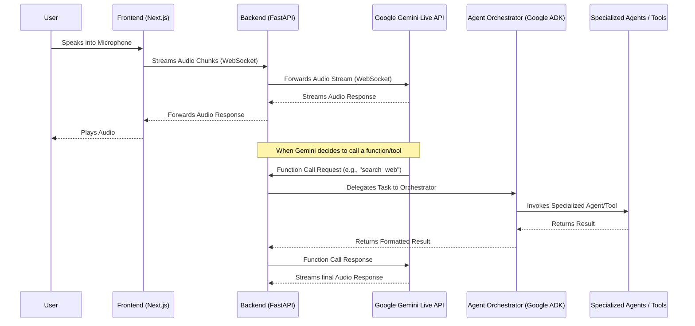

# Echo Architecture

This document describes the high-level architecture of the Echo project, focusing on the Multi-Agent system integrated with Google Gemini Live API.

## High-Level Data Flow

The following diagram illustrates the lifecycle of a user interacting with the Echo application via Voice.

## Backend Directory Structure (Domain-Driven & Agent-Oriented)

- `app/api/websockets/`: Handles the direct, stateful connections with the Next.js frontend.
- `app/services/gemini_live/`: Encapsulates all logic required to maintain the persistent WebSocket connection with Google's servers.
- `app/agents/orchestrator.py`: The brain of our multi-agent setup. It uses Google ADK to parse intent, plan, and delegate tasks to specialized agents.
- `app/agents/tools/`: Where individual functions (e.g., querying a database, searching the web, calling external APIs) reside.
- `app/agents/specialized/`: Agents built for specific tasks (e.g., `ResearchAgent`, `CodeReviewAgent`).

This architecture ensures that the system is scalable and new agents or tools can be plugged in easily without disrupting the core audio streaming logic.
