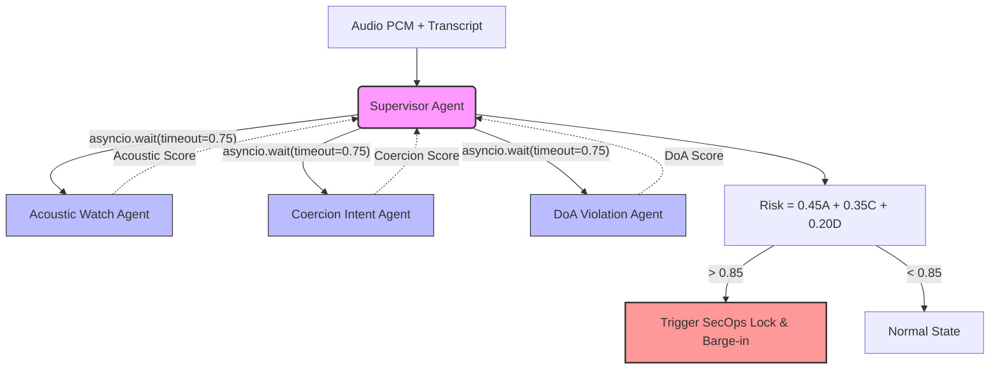
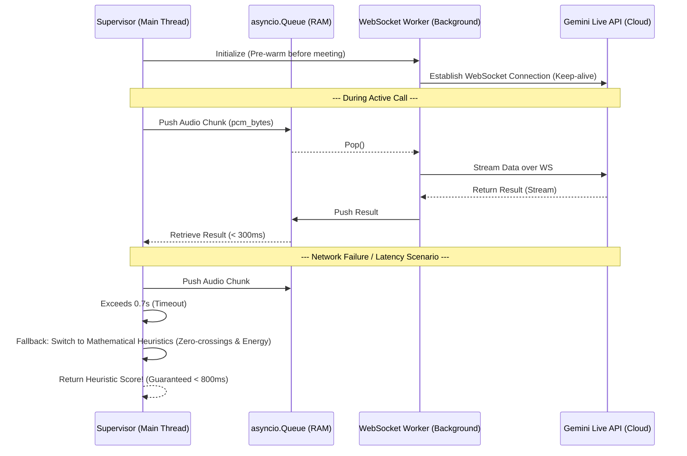
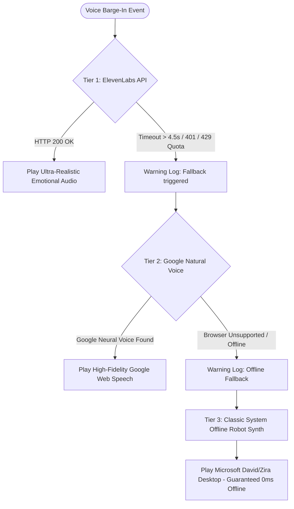
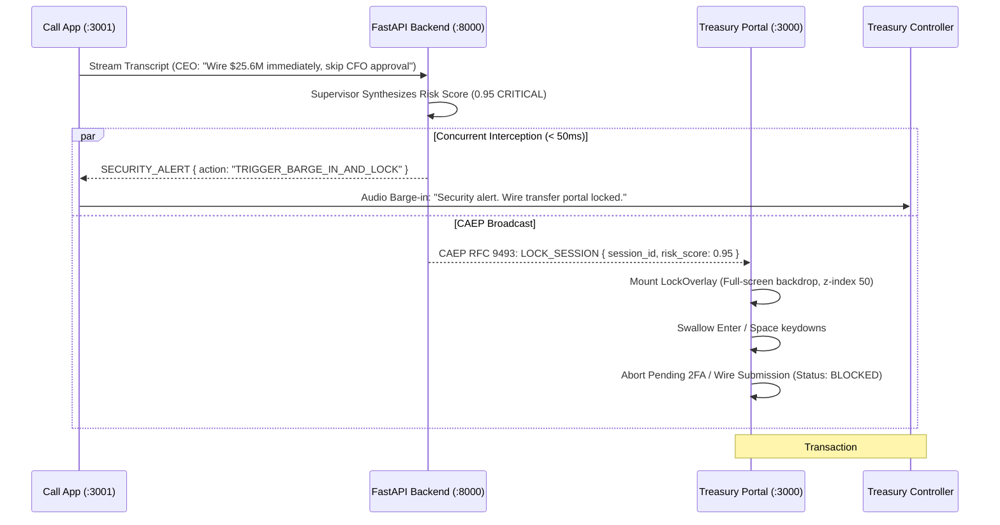

# ECHO-32 System Architecture

This document describes the current architecture of the **ECHO** project after being upgraded to meet Real-time High-Frequency Trading (HFT) standards.

## 1. Multi-Agent Orchestration

The system utilizes a **Supervisor-Worker** model, where the `SupervisorAgent` acts as the orchestrator coordinating 3 sub-agents running in parallel. The key design principle is that the Supervisor enforces an **extremely strict SLA (Service Level Agreement) of < 800ms**. Any agent that exceeds this timeframe is immediately cancelled to guarantee that the entire system never hangs.

## 2. Acoustic Watch Agent: HFT Streaming Architecture

To process real-time audio at a **High-Frequency** standard, the `AcousticWatchAgent` does not use standard HTTP Requests. Instead, it employs a **Persistent Daemon** architecture combined with **In-Memory RAM Queues**.

## 3. Key Architectural Features (NFRs)

1. **True Asynchronous:** Completely eliminates Blocking I/O by utilizing `aio.models` for the Coercion Agent. The Python Event Loop is 100% liberated.
2. **Network Fault Tolerance:** The Hybrid AI architecture allows the system to fallback to Heuristics (Digital Signal Processing algorithms that run locally without a network) if the LLM Cloud servers are congested.
3. **Persistent WebSocket:** Saves ~1 second of network overhead for every audio chunk by completely avoiding repetitive SSL/TLS Handshakes.

## 4. False-Positive Mitigation & Human-in-the-Loop (ECHO-33)

To prevent legitimate business conversations from triggering accidental meeting locks or voice barge-in interruptions:

1. **Contextual Cross-Validation (DoA Whitelist Attenuation):**
   - If an isolated Coercion urgency spike occurs ($C \ge 0.90$), but the beneficiary is in the verified ERP Whitelist ($D = 0.0$) and the voice acoustic is natural ($A < 0.30$), the Supervisor applies **Contextual Attenuation**. The risk is capped at `WARNING` (0.65) rather than escalating straight to `CRITICAL` (0.95).
2. **Codec/VoIP Noise Filtering (Acoustic Attenuation):**
   - Isolated acoustic glitches caused by VoIP compression or packet loss ($A \ge 0.90$) with zero coercion ($C < 0.20$) and compliant DoA ($D = 0.0$) are downgraded to `WARNING` to prevent erroneous locks on poor microphone setups.
3. **Temporal Multi-turn Smoothing:**
   - In live call streams (`/ws/call`), single isolated urgency signals trigger a `PROVISIONAL_ALERT`. Critical lockdown actions require either explicit malicious tactics (`BYPASS_FOUR_EYES`, `FORCED_SECRECY`) or multi-turn consecutive confirmation ($\ge 2$ turns).
4. **Human-in-the-Loop Override & Feedback:**
   - **REST API:** `POST /api/alerts/{session_id}/dismiss` allows SecOps operators to unlock an enforced session, suppress subsequent alarms, and log the feedback audit record for continuous model tuning.
   - **WebSocket Action:** Supports `{ "type": "dismiss_alert", "reason": "..." }` directly from the client.

## 5. 3-Tier Speech Synthesis & Voice Barge-In Architecture

To deliver emergency spoken alerts without risking call audio lockup or external dependency failures, the client speech engine employs a **3-tier progressive cascade**:

1. **Tier 1 — ElevenLabs Turbo v2.5 (`xi-api-key`):**
   - Generates hyper-realistic vocal delivery with expressive inflection, panic cadence, and telephone audio artifacts.
   - Guarded by an `AbortController` timeout guard (4.5s) to guarantee zero latency stalls under packet drops.
2. **Tier 2 — Google Natural Voice (Browser Neural Fallback):**
   - Leverages Chrome's pre-warmed Google Neural speech models (`Google US English`, `Google UK English`, `Google Vietnamese`).
   - Instant zero-token fallback when ElevenLabs credits are exhausted or network drops occur.
3. **Tier 3 — Classic System Robot Synth (Zero-Failure Fallback):**
   - Operating system local synthesized voice (`Microsoft David Desktop`, `Microsoft Zira`).
   - 100% offline, zero-network, guaranteeing critical security warnings are never silenced.

## 6. Cross-Application Zero-Trust Policy Enforcement (CAEP RFC 9493)

Echo decouples the **Communication Layer** (Conference call app on `:3001`) from the **Financial Settlement Layer** (Corporate treasury portal on `:3000`). When fraud is confirmed, Echo issues a Continuous Access Evaluation Profile (**CAEP RFC 9493**) session revocation event:

### Key Enforcement Mechanisms:
- **Input Trapping:** The `LockOverlay` listens to the global `window` capture phase and cancels `Enter` and `Space` keypresses, preventing coerced employees from completing the 2FA submission under emotional duress.
- **Dual-State Verification:** Even if client-side code were tampered with, the backend ledger freezes the transaction `#TX-2026-ARUP88` server-side, returning HTTP 403 on wire settlement endpoints.
- **SecOps Audit Trail:** An operator override endpoint (`POST /api/alerts/{session_id}/dismiss` and `POST /api/erp/unlock`) enforces auditable human verification before any frozen funds can be released.

