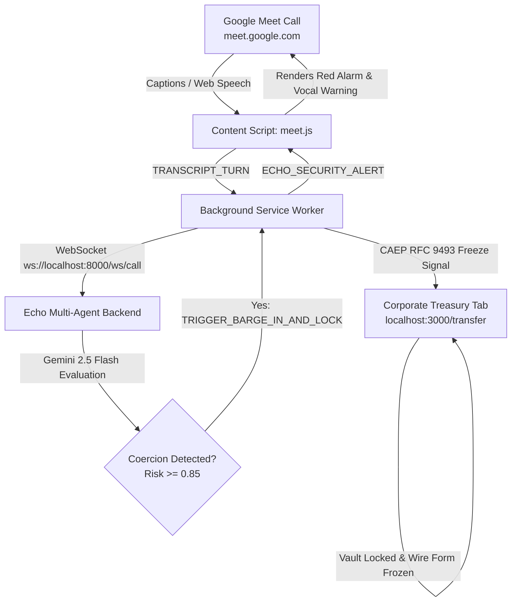

# 🛡️ Echo Guard — Chrome Extension for Google Meet

> **Zero-Trust AI Voice & Dialogue Defense Against Deepfake Executive Impersonation & BEC Wire Fraud**

---

## 🌟 Why a Chrome Extension?
Instead of forcing enterprise organizations to migrate away from **Google Meet**, **Echo Guard** integrates seamlessly as a lightweight, non-intrusive **Manifest V3 Chrome Extension**.

### Key Capabilities:
- **Native Google Meet HUD:** Injects a minimalist, floating status badge in Google Meet (`🛡️ Echo Guard: Secure`).
- **Live Dialogue Interception:** Continuously captures meeting dialogue via Google Meet's live closed captions and/or Web Speech API without interfering with the call.
- **Sub-Second Gemini Reasoning:** Streams dialogue turns over secure WebSocket (`ws://localhost:8000/ws/call`) to the Echo Multi-Agent Security Engine.
- **Emergency In-Call Barge-In Alarm:** When BEC coercion or DoA bypass is identified, an inescapable red alert overlay drops directly onto Google Meet with audible siren and synthesized voice warnings.
- **Cross-Tab Zero-Trust Banking Lock (CAEP RFC 9493):** Simultaneously transmits an emergency freeze signal to open Corporate Treasury tabs (`http://localhost:3000/transfer`), preventing unauthorized wire execution in real time.

---

## 🚀 Quick Setup (Load Unpacked in Chrome)

1. Open **Google Chrome** (or any Chromium browser: Brave, Edge, Opera).
2. Navigate to:
   ```text
   chrome://extensions
   ```
3. Enable **Developer mode** toggle in the top-right corner.
4. Click **Load unpacked** in the top-left toolbar.
5. Select the `extension/` folder inside this repository:
   ```text
   e:\Hackathon\Google AI Builder Cup 2026\Echo\extension
   ```
6. The **Echo Guard** icon will now appear in your browser extensions toolbar! Click the puzzle icon and pin **Echo Guard** for quick access.

---

## 🎬 How to Run the Live Hackathon Demo

### Prerequisites:
Ensure the Echo backend and frontend are running:
```bash
# Terminal 1: Echo Multi-Agent Backend
cd backend
python -m uvicorn app.main:app --reload --port 8000

# Terminal 2: Corporate Treasury Web Portal
pnpm run dev:frontend  # runs at http://localhost:3000
```

### Scenario 1: Real Google Meet Meeting
1. Open a Google Meet call at **[meet.google.com/new](https://meet.google.com/new)**.
2. In another tab or split window, open the **Treasury Portal** at **`http://localhost:3000/transfer`**.
3. In Google Meet, notice the sleek **Echo Guard** floating badge in the top right.
4. Press **`c`** to turn on Google Meet captions, OR click the **🎙️** icon on the Echo Guard badge to activate built-in speech transcription.
5. Speak or click **⚡ Simulate CEO Wire Attack** from the extension popup or the badge.
6. **Result:**
   - **Google Meet:** Emergency Barge-in Alarm drops over the video stream with audio siren and tactical breakdown (`[BYPASS_FOUR_EYES]`, `[AUTHORITY_INTIMIDATION]`).
   - **Treasury Portal (`localhost:3000`):** The wire transfer screen instantly freezes with a locked vault overlay via CAEP RFC 9493!

### Scenario 2: Local Test Sandbox (No Google Account Required)
1. Open **`http://localhost:3001/`** in Chrome.
2. Open **`http://localhost:3000/transfer`** in a second window.
3. Open the **Echo Guard extension popup** (click the extension icon in Chrome toolbar).
4. Click **Simulate CEO Wire Attack**.
5. Observe the instant zero-trust lock synchronizing across both tabs!

---

## 🏗️ Architecture



---

## ⚙️ Configuration
Click the extension icon, choose **⚙️ Settings**:
- **WebSocket Endpoint:** `ws://localhost:8000/ws/call` (or your deployed Google Cloud Run URL `wss://echo-backend-xyz.run.app/ws/call`).
