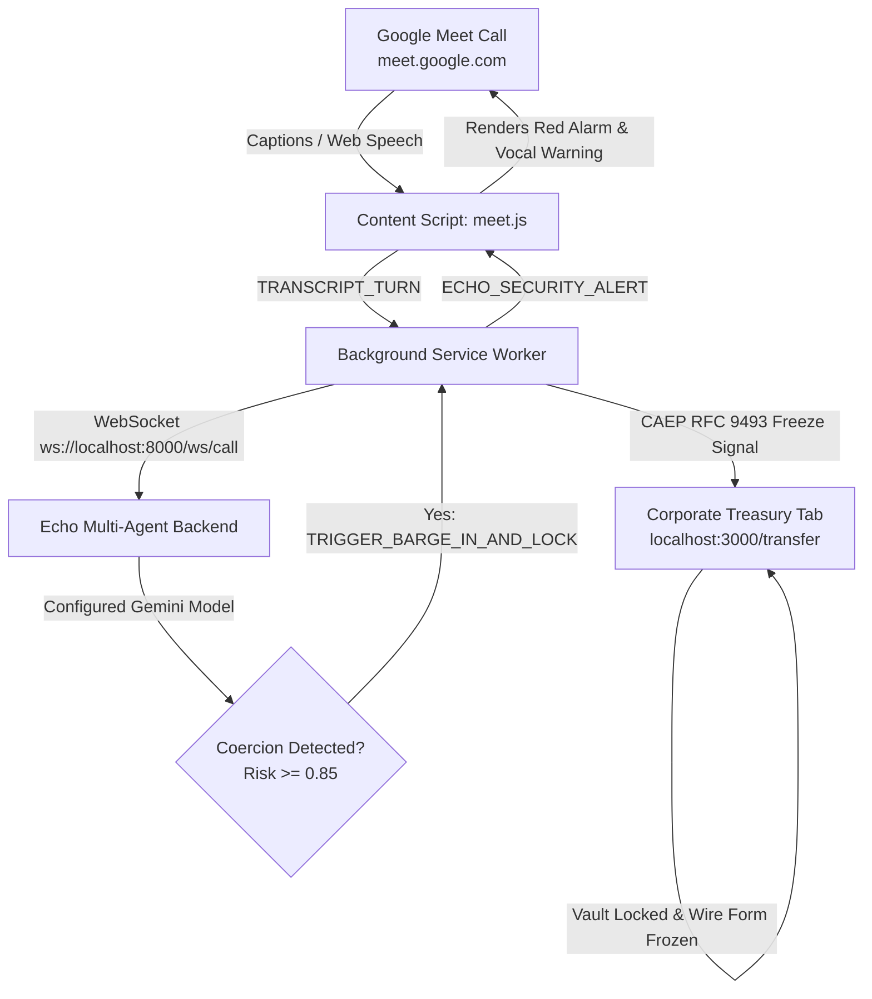

# 🛡️ Echo Guard — Chrome Extension for Google Meet

> **Zero-Trust AI Voice & Dialogue Defense Against Deepfake Executive Impersonation & BEC Wire Fraud**

---

## 🌟 Why a Chrome Extension?
Instead of forcing enterprise organizations to migrate away from **Google Meet**, **Echo Guard** integrates seamlessly as a lightweight, non-intrusive **Manifest V3 Chrome Extension**.

### Key Capabilities:
- **Native Google Meet HUD:** Injects a minimalist, floating status badge in Google Meet (`🛡️ Echo Guard: Secure`).
- **Live Dialogue Interception:** Continuously captures meeting dialogue via Google Meet's live closed captions and/or Web Speech API without interfering with the call.
- **Background Gemini Analysis:** Sends dialogue turns over WebSocket (`ws://localhost:8000/ws/call`) to the Echo security engine. Local screening is immediate; cloud response time depends on the provider.
- **Emergency In-Call Barge-In Alarm:** When BEC coercion or DoA bypass is identified, an inescapable red alert overlay drops directly onto Google Meet with audible siren and synthesized voice warnings.
- **Cross-Tab Zero-Trust Banking Lock (CAEP RFC 9493):** Simultaneously transmits an emergency freeze signal to open Corporate Treasury tabs (`http://localhost:3000/transfer`), preventing unauthorized wire execution in real time.

---

## 🚀 Quick Setup (Load Unpacked in Chrome)

1. Open **Google Chrome** (or any Chromium browser: Brave, Edge, Opera).
2. Navigate to:
   ```text
   chrome://extensions
   ```
3. Enable **Developer mode** toggle in the top-right corner.
4. Click **Load unpacked** in the top-left toolbar.
5. Select the `extension/` folder inside this repository:
   ```text
   <repository>/extension
   ```
6. The **Echo Guard** icon will now appear in your browser extensions toolbar! Click the puzzle icon and pin **Echo Guard** for quick access.

---

## 🎬 How to Run the Live Hackathon Demo

### Prerequisites:
Ensure the Echo backend and frontend are running:
```bash
# Terminal 1: Echo Multi-Agent Backend
cd backend
python -m uvicorn app.main:app --reload --port 8000

# Terminal 2: Corporate Treasury Web Portal
pnpm run dev:frontend  # runs at http://localhost:3000
```

### Scenario 1: Real Google Meet Meeting
1. Open a Google Meet call at **[meet.google.com/new](https://meet.google.com/new)**.
2. In another tab or split window, open the **Treasury Portal** at **`http://localhost:3000/transfer`**.
3. In Google Meet, notice the sleek **Echo Guard** floating badge in the top right.
4. Press **`c`** to turn on Google Meet captions, OR click the **🎙️** icon on the Echo Guard badge to activate built-in speech transcription.
5. Speak or click **⚡ Simulate CEO Wire Attack** from the extension popup or the badge.
6. **Result:**
   - **Google Meet:** Emergency Barge-in Alarm drops over the video stream with audio siren and tactical breakdown (`[BYPASS_FOUR_EYES]`, `[AUTHORITY_INTIMIDATION]`).
   - **Treasury Portal (`localhost:3000`):** The wire transfer screen instantly freezes with a locked vault overlay via CAEP RFC 9493!

### Scenario 2: Local Test Sandbox (No Google Account Required)
1. Open **`http://localhost:3001/`** in Chrome.
2. Open **`http://localhost:3000/transfer`** in a second window.
3. Open the **Echo Guard extension popup** (click the extension icon in Chrome toolbar).
4. Click **Simulate CEO Wire Attack**.
5. Observe the instant zero-trust lock synchronizing across both tabs!

---

## 🏗️ Architecture



---

## ⚙️ Configuration
Click the extension icon, choose **⚙️ Settings**:
- **WebSocket Endpoint:** `ws://localhost:8000/ws/call` (or your deployed Google Cloud Run URL `wss://echo-backend-xyz.run.app/ws/call`).

## Monitoring recovery and bank release

Chrome/Chromium 116 or newer is required. Monitoring reconnects on every worker
activation, exchanges heartbeat messages every 20 seconds, and uses the `alarms`
permission for a one-minute recovery check. Pending captions are bounded to the
latest 30 while the socket reconnects. Alert state and recent transcripts use
`chrome.storage.session`, so worker suspension preserves them without writing
the conversation to persistent local storage.

Caption discovery observes page structure, while text-change observers attach
only to known caption containers. This captures in-place text edits without
watching all text changes on the page or feeding HUD mutations back into capture.
Alerts and status reach both Google Meet and the localhost:3001 call sandbox;
a newly loaded HUD requests the current status instead of assuming it is secure.

The popup independently subscribes to the backend's treasury guard channel,
derived from the configured WebSocket endpoint. **Review & release in Treasury**
opens an existing bank tab or creates one. Verify through the secondary channel,
enter audit notes, and select **Release Freeze** in the bank's operator controls.
Only the bank channel's confirmed release clears the frozen status and banner.
**Dismiss call alert** clears the call warning after backend acknowledgement;
it does not release a banking lock. Offline bank status is shown as unavailable.

## Regression checks

From the repository root, install dependencies and run the offline checks:

```sh
corepack pnpm install --frozen-lockfile
corepack pnpm test:extension
```

For the native extension browser regression, start the backend on port 8000,
the bank on 3000, and the call app on 3001. Start with an unlocked demo ledger.
Then install the test browser and run:

```sh
corepack pnpm exec playwright install chromium --no-shell
corepack pnpm test:extension:browser
```

The browser test installs the actual unpacked extension into a temporary isolated
Chromium profile. It checks pre-existing captions, in-place edits, HUD mutation
isolation, cross-tab fraud alerts, worker restart and alert restoration, treasury
verification/release, offline status, endpoint changes, and quiet monitoring
beyond the worker idle window. Scoring uses the running backend's configured
Gemini or local fallback and records the actual source. Screenshots and a JSON
report are written to a temporary directory printed at the end; set
`ECHO_TEST_ARTIFACTS` to an existing directory to choose another location.

The Meet DOM is a controlled fixture under a Meet URL. A signed-in live meeting,
physical microphone, and audible speech output still require manual verification.
The extension CI workflow runs offline tests and syntax checks on PRs into
`Staging` and `main`, without Google credentials or live browser sessions.
